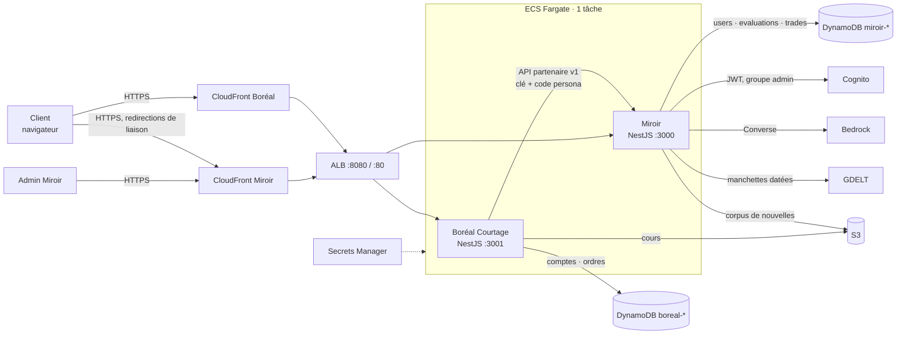

# Miroir + Boréal Courtage — AlphaForge AI (Datathon PolyFinances 2026)

> Ce que vous dites de vous comme investisseur, et ce que vous faites vraiment.

Ce dépôt contient **deux applications web distinctes** qui ne se parlent que par HTTP :

| Application | Rôle | Local | Code |
| --- | --- | --- | --- |
| **Miroir** | Notre service. Bâtit le profil comportemental d'un investisseur (déclaré contre observé), l'aide à se fixer ses propres règles, enquête sur chaque ordre reçu et mesure la dérive de son comportement. | http://localhost:3000 | `src/miroir`, `public/miroir` |
| **Boréal Courtage** | Une plateforme de courtage **fictive**, le « client » de Miroir. Comptes, portefeuille, ordres, historique. Miroir y est une option que chaque client active ou non. | http://localhost:3001 | `src/bank`, `public/bank` |

**Simulation uniquement** : capital fictif, aucun ordre réel, aucun conseil financier. Boréal Courtage n'existe pas.

## Démarrer

```bash
npm install
npm run build
npm start            # lance les deux applications (3000 et 3001)
npm run test:e2e     # dans un autre terminal : rejoue tout le parcours par les API
```

- Commencer par **http://localhost:3001** (la plateforme de courtage) et y ouvrir un compte.
- Admin Miroir : http://localhost:3000, `admin@miroir.local` / `admin123`.
- Repartir de zéro : arrêter, supprimer `data/db.json` (Miroir) et `data/bank-db.json` (Boréal), relancer.
- Une seule application : `npm run start:miroir` ou `npm run start:bank`.
- Sans compte AWS, tout fonctionne en mode local (`json` / `local` / `mock` / `template`).

## Parcours

1. Le client ouvre un compte chez **Boréal Courtage**. La plateforme lui propose Miroir.
   - **Non merci** : compte de courtage ordinaire. Ses ordres sont exécutés et conservés dans son historique ; rien ne sort de la plateforme. L'option « Activer Miroir » reste dans son compte.
   - **Activer Miroir** (à l'ouverture du compte ou plus tard) : il est envoyé chez Miroir.
2. Chez **Miroir**, il crée un compte Miroir (distinct de son compte de courtage) et passe l'évaluation :
   13 questions (profil **déclaré**), 5 mises en situation tirées de prix réels masqués (profil **observé**),
   la révélation de ce qui s'est vraiment passé, puis ses propres règles sur ses paramètres fragiles.
3. Il est **ramené chez Boréal** avec un code à usage unique, que le serveur de Boréal échange contre un
   **code persona**. Ce code accompagne ensuite chaque requête vers Miroir : c'est lui qui dit à quel profil appartient un ordre.
4. À chaque ordre chez Boréal :
   - **avant** : Boréal demande à Miroir si l'ordre touche une règle ; si oui, la règle que le client s'est fixée lui est rappelée, et il confirme ou renonce ;
   - **après** : l'ordre exécuté est envoyé à Miroir, qui enquête (marché, nouvelles, comportement), met à jour le profil et le score de dérive, et renvoie une explication.
5. Quand la dérive atteint 60, Miroir demande une **réévaluation** : les ordres sont suspendus chez Boréal jusqu'à ce que le client la refasse chez Miroir (ou retire Miroir de son compte).
6. Le client peut **retirer Miroir** depuis Boréal ou depuis Miroir ; son compte redevient un compte ordinaire.
7. La **vue admin** de Miroir montre tous les personas, profils, règles, ordres et enquêtes, en temps réel.

## La liaison entre les deux applications

```
Boréal (navigateur)            Boréal (serveur)               Miroir (serveur)              Miroir (navigateur)
 « Activer Miroir » ─────────▶ POST /api/miroir/link/start
                               state aléatoire mémorisé
 ◀── redirection vers Miroir /?link=1&state=…&return=<Boréal>/app.html ─────────────────────▶ compte Miroir + évaluation
                                                              POST /api/link/authorize ◀───── « Activer mon profil et retourner »
                                                              code à usage unique (5 min)
 ◀── redirection vers <Boréal>/app.html?code=…&state=… ◀──────────────────────────────────────
 POST /api/miroir/link/complete ▶ vérifie le state
                               POST /api/partner/v1/link/exchange  (x-partner-key) ─▶ code → CODE PERSONA
                               code persona conservé côté serveur
```

- Le **code de l'URL** ne vaut rien seul : il expire en 5 minutes, ne sert qu'une fois, et son échange exige la clé d'API de Boréal.
- Le **code persona** ne transite que de serveur à serveur et n'est jamais envoyé au navigateur.
- Les deux codes sont signés et contiennent l'identifiant de la liaison en cours : révoquer ou refaire la liaison les invalide, sans liste noire.
- Miroir n'accepte de renvoyer l'utilisateur que vers les origines listées dans `PARTNER_RETURN_ORIGINS`.

### API partenaire de Miroir (`/api/partner/v1`, serveur à serveur)

En-têtes : `x-partner-key` (toujours) et `x-persona-code` (toutes les routes sauf l'échange).

| Route | Quand | Effet |
| --- | --- | --- |
| `POST /link/exchange` `{code}` | au retour du client | code à usage unique → `{personaCode, persona}` |
| `GET /persona` | affichage | statut, score de dérive, texte des règles (pas le profil) |
| `POST /trades/check` | **avant** un ordre | règles à rappeler, avertissements de cohérence, `reevaluationRequired`. Aucun effet |
| `POST /trades` | **après** un ordre exécuté | enquête, mise à jour du profil et de la dérive, explication |
| `POST /trades/abandon` | le client renonce après le rappel | « règle respectée » : les paramètres concernés se rapprochent de la référence |
| `DELETE /link` | le client retire Miroir | révoque la liaison |

Corps d'un ordre : `{ticker, side, amount, marketDate, decisionTimeMs, note, externalId, portfolio: {cash, positions: [{ticker, value}]}}`,
où `portfolio` est le portefeuille **avant** l'ordre. Miroir ne détient aucun portefeuille : il calcule les poids à partir de ce que la plateforme lui envoie.

## Le profil : 6 paramètres (0–100)

Appétit pour le risque, réaction aux pertes, attrait pour le « hype », concentration, impulsivité, sensibilité aux nouvelles.
Chacun existe en trois versions : **déclaré** (questionnaire), **référence** (observé à la dernière évaluation), **actuel** (mis à jour par les ordres).

**Score de dérive** = 1,5 × plus grand écart d'un paramètre + écart moyen + 8 points par règle outrepassée (`src/miroir/trades/drift.ts`).

## Services AWS

| Service | Rôle | Pourquoi ce choix |
| --- | --- | --- |
| **Amazon Bedrock** (Claude Haiku 4.5, API Converse) | Trois agents de Miroir : **nouvelles** (sélectionne, classe et reformule les vraies manchettes), **influence** (« changement de comportement ou influence externe ? »), **explicabilité** (rédige le résumé de l'enquête) | Le seul endroit où un modèle de langage apporte quelque chose : lire des manchettes et formuler une explication. Appel direct (Converse) : la récupération des nouvelles et la fenêtre de dates restent dans le code, donc vérifiables |
| **Amazon DynamoDB** | Miroir : utilisateurs, évaluations, ordres et enquêtes (3 tables). Boréal : comptes et ordres (2 tables distinctes) | Accès par clé uniquement ; à la demande ; les deux applications ne partagent aucune table |
| **Amazon Cognito** | Comptes Miroir, mots de passe, jetons JWT, groupe `admin` | Miroir ne stocke aucun mot de passe. Boréal garde une authentification locale : c'est un partenaire de démonstration |
| **Amazon S3** | Jeu de données, scénarios, corpus de nouvelles | Source unique et versionnée, traçabilité des manchettes récupérées |
| **ECS Fargate + ALB** | Une tâche à deux conteneurs (même image) : Miroir (ALB:80) et Boréal (ALB:8080) | Boréal appelle l'API partenaire par `localhost` : ce trafic ne sort pas de la tâche |
| **Amazon CloudFront** | Une distribution HTTPS par application | Chiffrement en transit sans nom de domaine à gérer ; deux origines publiques distinctes, comme deux entreprises |
| **Secrets Manager** | Mot de passe admin, secret de signature des codes de liaison, clé d'API partenaire, secret des sessions Boréal | Aucun secret dans le dépôt |
| **ECR + CodeBuild**, **CloudWatch Logs** | Image et journaux | Déploiement sans Docker sur le poste |

Non retenus, volontairement : **EventBridge / AppSync** (le flux admin en mémoire suffit avec une tâche),
**SQS** entre Boréal et Miroir (l'appel synchrone permet d'afficher l'enquête tout de suite ; voir `KIRO_HANDOFF.md` pour la file de rattrapage),
**Bedrock Knowledge Bases** (un index vectoriel n'apporte rien à une recherche par actif et par date).

### Architecture



### Pipeline d'un ordre

```
Boréal  POST /api/trades/preview   validation + Miroir /trades/check        → règles à rappeler au client
Boréal  POST /api/trades           [1] pré-contrôle refait côté serveur (409 si une règle n'est pas confirmée,
                                       ou si Miroir exige une réévaluation)
                                   [2] exécution dans le portefeuille fictif + historique
                                   [3] Miroir /trades :
Miroir      Agent nouvelles        GDELT : manchettes des 7 jours AVANT la date → Bedrock : sélection, impact   (code + Bedrock)
            Agent gouvernance      règles personnelles touchées = outrepassées                                 (code)
            Agent comportement     constats sur seuils fixes, preuve chiffrée (socle vérifiable)              (code)
            Agent d'influence      verdict + constats supplémentaires bornés                                  (Bedrock)
            Profil + dérive        paramètres déplacés de 35 % vers le signal ; réévaluation si dérive ≥ 60     (code)
            Agent explicabilité    résumé (Bedrock) ; étapes, sources, hypothèses, limites (code)
            → stockage → événements temps réel vers la vue admin
Boréal  affiche le résumé de l'enquête ; l'enquête complète se lit dans Miroir
```

Si Miroir est injoignable, l'ordre passe quand même et est marqué « non analysé » : la plateforme ne dépend jamais de Miroir pour fonctionner.

### Garde-fous sur les sorties du modèle

- **Aucune fuite du futur** : la fenêtre de recherche (7 jours avant la date, jusqu'à 20 h UTC le jour même) est
  fixée par le code et revérifiée sur chaque article.
- **Rien d'inventé** : le modèle cite des manchettes et des faits par numéro (`N1`, `F3`) ; le code rejette toute
  référence inexistante. Un verdict « influence externe » sans nouvelle citée devient « impossible de conclure ».
  Un résumé contenant un chiffre absent des faits est remplacé par le résumé gabarit.
- **Effet borné** : l'agent d'influence n'agit que sur 3 paramètres (nouvelles, « hype », pertes), seulement s'ils
  ne sont pas déjà relevés par le socle et si son propre verdict signale quelque chose ; un constat ne peut que
  renforcer un paramètre, et son signal reste à ±15 points du signal calculé par le code.
- **Étiquetage** : tout texte produit par le modèle porte la mention « IA ». Les signaux de repli dérivés des prix
  portent la mention « simulé ».
- **Dire quand on ne sait pas** : aucune nouvelle trouvée → « aucun signal » ; recherche indisponible → repli sur
  les signaux simulés, et l'agent d'influence est prévenu qu'il ne peut rien conclure sur une influence externe.

## Variables d'environnement

**Miroir**

| Variable | Valeurs (défaut en gras) | Rôle |
| --- | --- | --- |
| `PORT` | **3000** | Port de Miroir |
| `STORAGE_DRIVER` | **json** · dynamodb | Persistance : `data/db.json` ou DynamoDB |
| `AUTH_DRIVER` | **local** · cognito | Authentification : locale (scrypt + HMAC) ou Cognito |
| `NEWS_DRIVER` | **mock** · bedrock | Nouvelles : signaux simulés ou GDELT + Bedrock |
| `INFLUENCE_DRIVER` | **off** · bedrock | Agent d'influence Bedrock |
| `EXPLAINER_DRIVER` | **template** · bedrock | Résumé de l'enquête : gabarit ou Bedrock |
| `PARTNER_API_KEY` | **dev-partner-key-change-me** | Clé d'API de la plateforme de courtage (même valeur des deux côtés) |
| `PARTNER_RETURN_ORIGINS` | **http://localhost:3001** | Origines (séparées par des virgules) vers lesquelles Miroir accepte de renvoyer l'utilisateur |
| `PARTNER_NAME` | **Boréal Courtage** | Nom du partenaire affiché à l'utilisateur |
| `LINK_SECRET` | (défaut : `JWT_SECRET`) | Signe les codes de liaison et les codes persona. **À définir en production** |
| `JWT_SECRET` | | Signature des jetons en mode `local` |
| `ADMIN_EMAIL`, `ADMIN_PASSWORD` | **admin@miroir.local**, **admin123** | Compte admin créé au démarrage |
| `DRIFT_THRESHOLD` | **60** | Seuil de réévaluation |
| `NEWS_TIMEOUT_MS` | **20000** | Attente maximale des nouvelles pendant une enquête ; au-delà, signaux simulés étiquetés |
| `BEDROCK_TIMEOUT_MS` | **15000** | Attente maximale d'un appel Bedrock (influence, résumé) |
| `GDELT_PATIENCE_MS` | **15000** | Attente maximale de GDELT pendant une enquête |
| `PIPELINE_STEP_DELAY_MS` | **350** (mock), **0** (bedrock) | Pause entre les étapes, pour la démo de la vue admin |
| `BEDROCK_MODEL_ID` | **us.anthropic.claude-haiku-4-5-20251001-v1:0** | Profil d'inférence Bedrock |
| `COGNITO_USER_POOL_ID`, `COGNITO_CLIENT_ID` | | Sorties de la pile `MiroirData` |
| `USERS_TABLE`, `EVALUATIONS_TABLE`, `TRADES_TABLE` | **miroir-users**, **miroir-evaluations**, **miroir-trades** | Tables de Miroir |

**Boréal Courtage**

| Variable | Valeurs (défaut en gras) | Rôle |
| --- | --- | --- |
| `BANK_PORT` | **3001** | Port de la plateforme |
| `BANK_PUBLIC_URL` | **http://localhost:3001** | Adresse publique de la plateforme (adresse de retour de la liaison) |
| `MIROIR_PUBLIC_URL` | **http://localhost:3000** | Adresse de Miroir vue par le navigateur (redirections) |
| `MIROIR_API_URL` | **http://localhost:3000** | Adresse de l'API partenaire, de serveur à serveur |
| `PARTNER_API_KEY` | **dev-partner-key-change-me** | Clé d'API présentée à Miroir |
| `BANK_JWT_SECRET` | | Signature des sessions de la plateforme |
| `BANK_STORAGE_DRIVER` | **json** · dynamodb | `data/bank-db.json` ou DynamoDB |
| `BANK_ACCOUNTS_TABLE`, `BANK_TRADES_TABLE` | **boreal-accounts**, **boreal-trades** | Tables de la plateforme |
| `MIROIR_CHECK_TIMEOUT_MS`, `MIROIR_SUBMIT_TIMEOUT_MS` | **8000**, **50000** | Attente maximale du pré-contrôle et de l'enquête |

**Communes** : `AWS_REGION` (**us-east-1**), `DATA_BUCKET` (vide = disque local).

## Infrastructure (`infra/`, AWS CDK TypeScript)

| Pile | Contenu |
| --- | --- |
| `MiroirData` | Tables DynamoDB de Miroir (3) et de Boréal (2), User Pool + groupe `admin`, bucket S3 privé et envoi de `dataset/` et `data/` |
| `MiroirBuild` | Dépôt ECR, projet CodeBuild qui construit le `Dockerfile` (une image pour les deux applications) |
| `MiroirApp` | VPC sans NAT, une tâche Fargate à deux conteneurs, ALB (ports 80 et 8080) accessible seulement depuis CloudFront, deux distributions CloudFront, 4 secrets. La liste de préfixes CloudFront pèse 55 règles sur 60 par groupe de sécurité : chaque port a donc son propre groupe, attaché au même ALB |

Déploiement : `cd infra && ./deploy.sh` (affiche les deux adresses). La topologie à deux conteneurs a été écrite sans accès à AWS
et validée seulement par `cdk synth` : voir les hypothèses à vérifier dans `KIRO_HANDOFF.md`.

## Données, sources et traçabilité

| Données | Source | Documentation |
| --- | --- | --- |
| Prix, actions corporatives, change, taux | Jeu de données de départ (Yahoo Finance, Banque du Canada, FRED) | `dataset/README.md`, `dataset/sources_metadata.csv` |
| Manchettes de presse | [GDELT Project](https://www.gdeltproject.org) DOC 2.0 API, constitué le 2026-11-15 | `data/news_sources_metadata.csv` |
| Analyses des manchettes | Amazon Bedrock (sorties conservées) | `data/news/classified/`, `data/news/context/` |

**Pourquoi GDELT** : gratuit, sans clé, couvre 2017 à aujourd'hui (donc toute la période 2021-2026 du jeu de
données) et filtre par date. Les API de nouvelles gratuites courantes ne remontent qu'à un mois. GDELT est une base
ouverte, réutilisable avec citation ; Miroir ne conserve que le titre, le lien, l'éditeur et la date, jamais le texte
des articles. GDELT limite le débit (une requête toutes les 5 s, souvent davantage depuis les adresses AWS) : le
corpus des dates de démonstration est donc constitué à l'avance par
`node scripts/prefetch_news.mjs` (après `npm run build`), puis servi depuis S3. Un trade à une autre date interroge
GDELT en direct ; si GDELT ne répond pas à temps, l'enquête retombe sur des signaux simulés étiquetés comme tels.

## Structure

```
src/
  shared/       ce que les deux applications utilisent sans se connaître : cours (S3 ou disque), briques d'authentification locale
  miroir/       LE SERVICE
    auth/         contrat AuthService : LocalAuthService · CognitoAuthService ; gardes
    evaluation/   questionnaire, scénarios, diagnostic, règles, reprise d'une évaluation en cours
    partner/      liaison (code à usage unique → code persona) et API partenaire v1
    trades/       enquête sur un ordre reçu + agents (gouvernance, comportement, influence, explicabilité), dérive
    news/         contrat NewsProvider : MockNewsProvider · BedrockNewsProvider ; client GDELT ; corpus
    ai/           client Bedrock (Converse) et garde-fous sur les sorties du modèle
    storage/      contrat Store : JsonStore · DynamoStore
    realtime/, admin/   bus d'événements (SSE) et vue admin
  bank/         LA PLATEFORME DE COURTAGE FICTIVE (n'importe aucun module de miroir/)
    auth.ts               comptes clients (authentification locale)
    trading.service.ts    portefeuille, ordres, historique ; pré-contrôle et envoi à Miroir
    miroir-link.service.ts  activer, refuser, retirer Miroir
    miroir.client.ts      seul point de contact avec Miroir (HTTP)
    store.ts, dynamo.store.ts   JsonBankStore · DynamoBankStore
public/miroir/  connexion, évaluation, profil, admin        public/bank/  connexion, compte et ticket d'ordre
scripts/        build_scenarios.py · prefetch_news.mjs · e2e.mjs (deux applications) · start-all.mjs
dataset/, data/ jeu de données de départ ; scénarios, corpus de nouvelles, bases locales
infra/          AWS CDK ; Dockerfile : une image, deux commandes
```

## Hypothèses et limites

- Prix : Yahoo Finance via `yfinance`, 2021-11-12 → 2026-11-12, extraction du 2026-11-13 (`dataset/README.md`, `dataset/sources_metadata.csv`).
- Rendements calculés sur `adj_close` ; prix d'exécution = `close`. Calendriers alignés par report de la dernière valeur connue.
- **Date de marché simulée** : chez Boréal, chaque ordre est daté et exécuté au cours de clôture de cette date. Cette horloge avance, jamais ne recule ; le portefeuille est valorisé à la date du dernier ordre.
- Les scénarios sont détectés par des seuils fixes (ex. « chute » = −25 % en 30 séances). Les manchettes des simulations sont fictives et étiquetées ; la révélation n'utilise que les prix.
- Seuils des constats fixés à la main (`PARAM_CHECKS`) ; « spéculatif » = crypto ou volatilité annualisée ≥ 45 % ; poids d'un constat = 35 %.
- Le profil mesure un comportement, pas un rendement. Cinq situations donnent un signal, pas un diagnostic psychologique.
- Miroir fait confiance au portefeuille que la plateforme lui envoie ; il ne peut pas le vérifier.
- Nouvelles : anglais uniquement, couverture inégale selon les actifs ; une nouvelle publiée avant l'ordre ne prouve pas que l'investisseur l'a lue.
- L'impact des nouvelles et le verdict d'influence sont des estimations d'un modèle, bornées et vérifiées par le code.
- Montants non convertis entre CAD et USD ; biais du survivant dans l'univers d'actifs ; aucune donnée ESG.
- Inscription Cognito confirmée par le serveur (pas de code envoyé par courriel) : simplification de démo.
- Une seule tâche Fargate : le flux temps réel de la vue admin est en mémoire.

### Limites connues et assumées (non corrigées dans cette version)
Ces trois points sont connus, décrits ici pour que personne n'ait à les découvrir. Chacun a une piste de correction
dans `KIRO_HANDOFF.md`, section 6.

1. **Ordre non analysé si Miroir est injoignable.** Boréal exécute l'ordre, puis l'envoie à Miroir. Si Miroir ne
   répond pas à cet instant, l'ordre reste exécuté mais marqué « non analysé » et n'est jamais renvoyé : le profil et
   le score de dérive ne le voient pas. Il n'y a ni file d'attente ni nouvelle tentative. *Piste : file SQS entre les
   deux applications ; le renvoi serait sans danger, car chaque ordre porte déjà un `externalId` qui le rend idempotent.*
2. **Écritures concurrentes dans DynamoDB.** Deux ordres du même investisseur traités au même moment peuvent
   s'écraser : Miroir lit le profil, calcule, puis réécrit le document entier, sans contrôle de version. Le profil et
   le score de dérive peuvent alors perdre une mise à jour. Le risque est faible avec un seul utilisateur qui clique à
   la main, réel si des ordres arrivent en parallèle. *Piste : numéro de version et `ConditionExpression` à l'écriture.*
3. **Un seul rôle IAM pour les deux applications.** Elles tournent dans la même tâche ECS, donc partagent le même
   rôle. Boréal a ainsi, en théorie, accès à Bedrock, à Cognito et aux tables `miroir-*`, dont elle n'a pas besoin.
   Le code de Boréal ne les utilise pas, mais l'isolation est faite par le code et non par les droits.
   *Piste : deux services ECS, un rôle chacun.*
