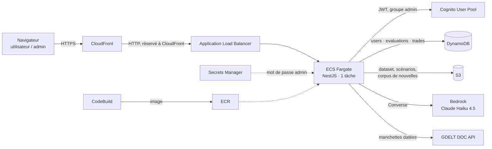

# Miroir — AlphaForge AI (Datathon PolyFinances 2026)

> Ce que vous dites de vous comme investisseur, et ce que vous faites vraiment.

Miroir bâtit le profil comportemental d'un investisseur en comparant ce qu'il **déclare** à ce qu'il
**fait** dans des situations de marché réelles (rendues méconnaissables), l'aide à **se fixer ses propres
règles**, puis **enquête sur chaque trade simulé** pour mesurer à quel point son comportement dérive.

**Simulation uniquement** — aucune transaction réelle, aucun conseil financier.

## Démarrer

### En local, sans compte AWS

```bash
npm install
npm run build
npm start            # http://localhost:3000
npm run test:e2e     # (serveur lancé) rejoue tout le pipeline par l'API
```

- Admin : `admin@miroir.local` / `admin123` (modifiable par variables d'environnement, voir `.env.example`)
- Mot de passe des comptes : 8 caractères minimum, avec au moins une minuscule et un chiffre
- Repartir de zéro : supprimer `data/db.json`
- Régénérer la bibliothèque de simulations : `npm run scenarios` (Python 3, aucune dépendance)

### En local, avec les services AWS

```bash
cp .env.example .env    # puis remplir les identifiants du User Pool et du bucket (sorties de infra/)
set -a; . ./.env; set +a; npm start
```

Chaque service se choisit séparément (voir [Variables d'environnement](#variables-denvironnement)) :
on peut par exemple activer seulement Bedrock et garder le stockage JSON.

### Déployer sur AWS

```bash
cd infra && npm install && ./deploy.sh      # ≈ 15 min la première fois, aucun Docker requis en local
BASE_URL=https://<distribution>.cloudfront.net \
  ADMIN_PASSWORD=$(aws secretsmanager get-secret-value --secret-id miroir/admin-password --query SecretString --output text) \
  npm run test:e2e
```

## Parcours

1. **Connexion / création d'utilisateur** (`/`)
2. **Évaluation** (`/onboarding.html`)
   1. 13 questions : faits (âge, horizon, objectif, ESG, crypto…) + comment il se voit → **profil déclaré**
   2. 5 mises en situation tirées des prix réels 2021-2026, masquées (nom et manchette fictifs, prix en base 100) → **profil observé**
   3. Révélation : l'actif réel, la date, ce qui s'est passé ensuite, le résultat en $ de chaque décision possible,
      et **ce que disaient les médias juste avant la décision** (vraies manchettes citées, résumé étiqueté IA)
   4. Règles : pour chaque paramètre fragile, l'utilisateur écrit sa propre règle (texte + seuil)
3. **Tableau de bord** (`/dashboard.html`) : profil, score de dérive, règles, simulation de trades.
   Si un trade touche une règle, elle lui est rappelée avant qu'il puisse poursuivre.
4. **Enquête** sur chaque trade : vraies nouvelles des 7 jours précédents, constats chiffrés, verdict
   « changement de comportement ou influence externe ? » → mise à jour des paramètres et du **score de dérive**
   → au-delà de 60, réévaluation obligatoire.
5. **Vue admin** (`/admin.html`) : tous les utilisateurs, profils, règles, trades et enquêtes, en temps réel.

## Le profil : 6 paramètres (0–100)

Appétit pour le risque · Réaction aux pertes · Attrait pour le « hype » · Concentration · Impulsivité · Sensibilité aux nouvelles.
Chacun existe en trois versions : **déclaré** (questionnaire), **référence** (observé à la dernière évaluation), **actuel** (mis à jour par les trades).

**Score de dérive** = 1,5 × plus grand écart d'un paramètre + écart moyen + 8 points par règle outrepassée (`src/trades/drift.ts`).

## Services AWS

Chaque service a un rôle précis dans le parcours. Aucun n'est là pour la vitrine.

| Service | Rôle dans Miroir | Pourquoi ce choix |
| --- | --- | --- |
| **Amazon Bedrock** (Claude Haiku 4.5, API Converse) | Trois agents : **nouvelles** (sélectionne, classe et reformule les vraies manchettes), **influence** (« changement de comportement ou influence externe ? »), **explicabilité** (rédige le résumé de l'enquête) | Le seul endroit où un modèle de langage apporte quelque chose : lire des manchettes et formuler une explication. Haiku : 1 à 2,5 s par appel, coût faible, suffisant pour classer et résumer. Appel direct (Converse) plutôt que Bedrock Agents : la récupération des nouvelles et la fenêtre de dates restent dans le code, donc vérifiables, et la latence reste courte |
| **Amazon DynamoDB** | Utilisateurs, évaluations, trades et enquêtes (3 tables, documents stockés tels quels) | Accès par clé uniquement (utilisateur, évaluation, trades d'un utilisateur triés par date) : pas besoin de SQL. À la demande, sans serveur à gérer |
| **Amazon Cognito** | Comptes, mots de passe, jetons JWT, groupe `admin` | Miroir ne stocke plus aucun mot de passe. Le rôle admin vient du groupe Cognito, vérifié à chaque requête |
| **Amazon S3** | Jeu de données, scénarios, corpus de nouvelles (brut + analyses) et métadonnées des sources | Source unique et versionnée pour le conteneur ; traçabilité : on peut montrer exactement quelles manchettes ont été récupérées, et quand |
| **ECS Fargate + ALB** | Exécute le conteneur NestJS (1 tâche) | Conteneur unique, sans serveur à gérer ; le flux temps réel (SSE) exige une connexion longue |
| **Amazon CloudFront** | HTTPS public devant l'ALB (aucune mise en cache) | Chiffrement des mots de passe et jetons en transit sans nom de domaine ni certificat à gérer |
| **ECR + CodeBuild** | Construction et stockage de l'image | Déploiement sans Docker sur le poste |
| **Secrets Manager** | Mot de passe du compte admin, injecté dans le conteneur | Aucun secret dans le dépôt |
| **CloudWatch Logs** | Journaux du conteneur (durées et jetons des appels Bedrock, replis) | Diagnostic de la démo |

Non retenus, volontairement : **EventBridge / AppSync** (le flux admin en mémoire suffit avec une seule tâche),
**SQS / Step Functions** (le pipeline synchrone est plus simple à expliquer), **Bedrock Knowledge Bases**
(un index vectoriel n'apporte rien à une recherche par actif et par date).

### Architecture



### Pipeline d'un trade

```
POST /api/trades
 [1] Agent gouvernance     règles personnelles touchées ? → 409 tant qu'elles ne sont pas confirmées   (code)
 [2] Exécution fictive     portefeuille simulé de 100 000 $                                            (code)
 [3] Enquête
     Agent nouvelles       GDELT : manchettes des 7 jours AVANT la date → Bedrock : sélection, impact   (code + Bedrock)
     Agent comportement    constats sur seuils fixes, preuve chiffrée (socle vérifiable)              (code)
     Agent d'influence     verdict + constats supplémentaires bornés                                  (Bedrock)
 [4] Profil + dérive       paramètres déplacés de 35 % vers le signal ; réévaluation si dérive ≥ 60     (code)
 [5] Agent explicabilité   résumé en langage clair (Bedrock) ; étapes, sources, hypothèses, limites (code)
 → DynamoDB → événements temps réel vers la vue admin
```

### Garde-fous sur les sorties du modèle

- **Aucune fuite du futur** : la fenêtre de recherche (7 jours avant la date, jusqu'à 20 h UTC le jour même) est
  fixée par le code et revérifiée sur chaque article ; à la révélation, le modèle ne voit que les manchettes
  antérieures à la décision, pour ne jamais justifier une décision après coup.
- **Rien d'inventé** : le modèle cite des manchettes et des faits par numéro (`N1`, `F3`) ; le code rejette toute
  référence inexistante. Un verdict « influence externe » sans nouvelle citée devient « impossible de conclure ».
  Un résumé contenant un chiffre absent des faits est remplacé par le résumé gabarit.
- **Effet borné** : l'agent d'influence n'agit que sur 3 paramètres (nouvelles, « hype », pertes), seulement s'ils
  ne sont pas déjà relevés par le socle et si son propre verdict signale quelque chose ; un constat ne peut que
  renforcer un paramètre, et son signal reste à ±15 points du signal calculé par le code.
- **Étiquetage** : tout texte produit par le modèle porte la mention « IA ». Les signaux de repli dérivés des prix
  portent la mention « simulé ».
- **Dire quand on ne sait pas** : aucune nouvelle trouvée → « aucun signal » ; recherche indisponible → repli sur
  les signaux simulés, et l'agent d'influence est prévenu qu'il ne peut rien conclure sur une influence externe.

## Variables d'environnement

| Variable | Valeurs (défaut en gras) | Rôle |
| --- | --- | --- |
| `STORAGE_DRIVER` | **json** · dynamodb | Persistance : `data/db.json` ou DynamoDB |
| `AUTH_DRIVER` | **local** · cognito | Authentification : locale (scrypt + HMAC) ou Cognito |
| `NEWS_DRIVER` | **mock** · bedrock | Nouvelles : signaux simulés ou GDELT + Bedrock |
| `INFLUENCE_DRIVER` | **off** · bedrock | Agent d'influence Bedrock |
| `EXPLAINER_DRIVER` | **template** · bedrock | Résumé de l'enquête : gabarit ou Bedrock |
| `AWS_REGION` | **us-east-1** | Région de tous les services (ca-central-1 est bloquée dans le compte de l'atelier) |
| `BEDROCK_MODEL_ID` | **us.anthropic.claude-haiku-4-5-20251001-v1:0** | Profil d'inférence Bedrock |
| `DATA_BUCKET` | (vide) | Bucket S3 des données ; vide = disque local |
| `COGNITO_USER_POOL_ID`, `COGNITO_CLIENT_ID` | | Sorties de la pile `MiroirData` |
| `USERS_TABLE`, `EVALUATIONS_TABLE`, `TRADES_TABLE` | **miroir-users**, **miroir-evaluations**, **miroir-trades** | Noms des tables |
| `ADMIN_EMAIL`, `ADMIN_PASSWORD` | **admin@miroir.local**, **admin123** | Compte admin créé au démarrage (Secrets Manager en production) |
| `JWT_SECRET` | | Signature des jetons en mode `local` uniquement |
| `GDELT_PATIENCE_MS` | **15000** | Attente maximale de GDELT pendant une enquête (au-delà : repli) |
| `PIPELINE_STEP_DELAY_MS` | **350** (mock), **0** (bedrock) | Pause entre les étapes, pour la démo de la vue admin |
| `DRIFT_THRESHOLD` | **60** | Seuil de réévaluation |

## Infrastructure (`infra/`, AWS CDK TypeScript)

| Pile | Contenu |
| --- | --- |
| `MiroirData` | 3 tables DynamoDB (à la demande, restauration à un instant donné), User Pool + client serveur + groupe `admin`, bucket S3 privé (chiffré, versionné, TLS obligatoire) et envoi de `dataset/` et `data/` |
| `MiroirBuild` | Dépôt ECR `miroir`, projet CodeBuild qui construit le `Dockerfile` |
| `MiroirApp` | VPC sans NAT, ECS Fargate (1 tâche, 0,5 vCPU, 1 Go), ALB accessible seulement depuis CloudFront, CloudFront HTTPS, secret admin |

**Rôle IAM de la tâche (moindre privilège)** : `bedrock:InvokeModel` sur le seul modèle configuré ; lecture/écriture
sur les 3 tables ; lecture du bucket et écriture limitée à `data/news/*` ; 6 actions d'administration Cognito sur ce
seul User Pool.

## Données, sources et traçabilité

| Données | Source | Documentation |
| --- | --- | --- |
| Prix, actions corporatives, change, taux | Jeu de données de départ (Yahoo Finance, Banque du Canada, FRED) | `dataset/README.md`, `dataset/sources_metadata.csv` |
| Manchettes de presse | [GDELT Project](https://www.gdeltproject.org) DOC 2.0 API, constitué le 2026-11-15 | `data/news_sources_metadata.csv` |
| Analyses des manchettes | Amazon Bedrock (sorties conservées) | `data/news/classified/`, `data/news/context/` |

**Pourquoi GDELT** : gratuit, sans clé, couvre 2017 à aujourd'hui (donc toute la période 2021-2026 du jeu de
données) et filtre par date. Les API de nouvelles gratuites courantes ne remontent qu'à un mois. GDELT est une base
ouverte, réutilisable avec citation ; Miroir ne conserve que le titre, le lien, l'éditeur et la date, jamais le texte
des articles. GDELT limite le débit (une requête toutes les 5 s, souvent davantage depuis les adresses AWS) : le
corpus des dates de démonstration et des 60 simulations est donc constitué à l'avance par
`node scripts/prefetch_news.mjs` (après `npm run build`), puis servi depuis S3. Un trade à une autre date interroge
GDELT en direct ; si GDELT ne répond pas à temps, l'enquête retombe sur des signaux simulés étiquetés comme tels.

## Structure

```
scripts/build_scenarios.py   bibliothèque de simulations (60 scénarios) à partir de dataset/prices_daily.csv
scripts/prefetch_news.mjs    constitution du corpus de nouvelles (GDELT + Bedrock)
scripts/e2e.mjs              test de bout en bout (BASE_URL pour viser l'environnement déployé)
dataset/                     jeu de données de départ (inchangé)
data/                        scenarios.json, assets.json (générés), news/ (corpus), db.json (base locale)
src/
  ai/           client Bedrock (Converse) et garde-fous sur les sorties du modèle
  auth/         contrat AuthService : LocalAuthService · CognitoAuthService ; gardes
  storage/      contrat Store : JsonStore · DynamoStore ; lecture des fichiers (S3 ou disque)
  evaluation/   questionnaire, scénarios, diagnostic, règles, contexte historique à la révélation
  market/       prix et indicateurs factuels
  news/         contrat NewsProvider : MockNewsProvider · BedrockNewsProvider ; client GDELT ; corpus
  trades/       pipeline du trade + agents (gouvernance, comportement, influence, explicabilité)
  realtime/     bus d'événements (SSE)
  admin/        API admin + flux temps réel
public/         4 pages HTML + JS sans framework ni build
infra/          AWS CDK : piles MiroirData, MiroirBuild, MiroirApp ; deploy.sh
Dockerfile      conteneur Node 22
KIRO_HANDOFF.md passation pour l'intégration AWS
```

## Hypothèses et limites

- Prix : Yahoo Finance via `yfinance`, 2021-11-12 → 2026-11-12, extraction du 2026-11-13 (`dataset/README.md`, `dataset/sources_metadata.csv`).
- Rendements calculés sur `adj_close` ; prix d'exécution = `close`. Calendriers alignés par report de la dernière valeur connue.
- Les scénarios sont détectés par des seuils fixes (ex. « chute » = −25 % en 30 séances). Les manchettes affichées pendant les simulations sont fictives et étiquetées comme telles ; le contexte historique de la révélation ne s'appuie que sur des manchettes réelles antérieures à la décision.
- Seuils des constats fixés à la main (`PARAM_CHECKS`) ; « spéculatif » = crypto ou volatilité annualisée ≥ 45 % ; poids d'un constat = 35 %.
- Le profil mesure un comportement, pas un rendement. Cinq situations donnent un signal, pas un diagnostic psychologique.
- Nouvelles : anglais uniquement, couverture inégale selon les actifs (meilleure pour les grandes capitalisations américaines et les cryptos que pour les titres de la TSX) ; pour un FNB, la recherche porte sur le marché suivi. Une nouvelle publiée avant le trade ne prouve pas que l'investisseur l'a lue.
- L'impact des nouvelles et le verdict d'influence sont des estimations d'un modèle, bornées et vérifiées par le code, pas des mesures.
- Montants non convertis entre CAD et USD ; biais du survivant dans l'univers d'actifs ; aucune donnée ESG (l'avertissement ESG dit explicitement qu'on ne peut pas conclure).
- Inscription Cognito confirmée par le serveur (pas de code envoyé par courriel) : simplification de démo.
- Une seule tâche Fargate : le flux temps réel de la vue admin est en mémoire.
